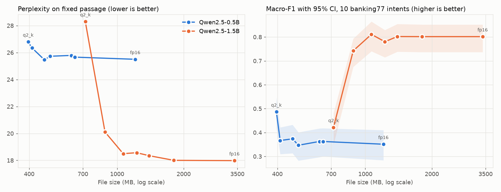

# Model Families and Quantization: A Guide

Oct 28, 2026 · Companion to `quantization_family_demo.py`

The main walkthrough asks which model to pick. This guide adds two choices that come after you pick a model: **which size** in its family, and **which quantization** of that size. On the Hugging Face Hub a single model often comes in a dozen or more downloadable variants. They share an architecture, a tokenizer and a training recipe, but they differ greatly in file size, memory, speed and quality.

The demo uses **Qwen2.5-Instruct**, because Qwen publishes the whole family in the same format: seven sizes (0.5B to 72B parameters), each in nine quantization levels (q2_k to fp16). That gives **63** variants of one model, all from one publisher, and you can measure every one with the same script.

**Choosing the model is half the decision. Choosing the size and precision is the other half, and it often matters more for cost.**

## Key ideas

**Model family.** A set of models trained with the same recipe at different sizes, such as Qwen2.5 0.5B, 1.5B, 3B, 7B, 14B, 32B and 72B. Larger members know more and reason better. Smaller members are faster and cheaper. Because the family shares a tokenizer and prompt format, you can swap one size for another without changing your code. That makes a family the cheapest way to trade quality against cost.

**Quantization.** Storing each weight with fewer bits. A model trained in 16-bit floating point (fp16, 2 bytes per weight) can be rounded to 8, 6, 5, 4, 3 or even 2 bits. Fewer bits means a smaller file, less RAM, and faster CPU inference, since CPU inference is mostly limited by memory bandwidth. The cost is rounding error, which shows up as a small loss in quality at 8 to 5 bits and a large one at 3 to 2 bits.

**GGUF.** The single-file model format used by [llama.cpp](https://github.com/ggml-org/llama.cpp) and the tools built on it (Ollama, LM Studio, llama-cpp-python). One `.gguf` file holds the weights, the tokenizer and the chat template. On the Hub, GGUF repos are usually named `<model>-GGUF`. Other quantized formats you will see on the Hub are GPTQ, AWQ and bitsandbytes (for GPUs with transformers) and MLX (for Apple silicon). The ideas in this guide apply to all of them.

**Reading a quantization name.** Take `q4_k_m`:

| Part | Meaning |
| --- | --- |
| `q4` | About 4 bits per weight on average |
| `_k` | A "k-quant": weights are stored in blocks of 256, each with its own scale factors, which keeps the rounding error low |
| `_m` | Medium mix. Sensitive layers (some attention and feed-forward tensors) are kept at higher precision. `_s` (small) keeps fewer, `_l` (large) keeps more |

The older `q4_0` and `q5_0` schemes use one scale per block of 32 weights and no mixing. They are simpler and sometimes faster, but less accurate for the same size. `q8_0` is 8-bit with one scale per block of 32 weights. `fp16` is no quantization at all.

**Bits per weight (bpw).** File size in bits divided by the number of parameters. It shows the *real* compression, which is always a little above the name: `q4_k_m` is about 4.9 bpw on the 7B model. On very small models it is much higher (see the results), because the embedding table is a large share of the weights and is kept at higher precision.

## The family on the Hub

**Where the 63 variants live.** They are not on one page. Each size is its own repo, and each quantization level is a *file* in that repo, visible under the repo's **Files and versions** tab rather than on the model card. From 7B up, large levels are split into shards (`...-q4_k_m-00001-of-00002.gguf`), so the 7B repo shows 19 files for its 9 levels. The repos are grouped in Qwen's [Qwen2.5 collection](https://huggingface.co/collections/Qwen/qwen25-66e81a666513e518adb90d9e), alongside base, Coder and Math variants. The "Quantizations" link in a model page's sidebar is different: it lists community-made quantizations, not Qwen's own.

To see the two ends of the family side by side, open the file lists of the smallest and largest members:

- **Smallest:** [Qwen2.5-0.5B-Instruct-GGUF, Files and versions](https://huggingface.co/Qwen/Qwen2.5-0.5B-Instruct-GGUF/tree/main). Nine single files, from 0.42 GB (q2_k) to 1.27 GB (fp16).
- **Largest:** [Qwen2.5-72B-Instruct-GGUF, Files and versions](https://huggingface.co/Qwen/Qwen2.5-72B-Instruct-GGUF/tree/main). The same nine levels, from 27 GB (q2_k) to 146 GB (fp16), split into 145 shard files (even q2_k is 7 shards).

Run `python quantization_family_demo.py --list` to rebuild this table from live Hub data. It finds the seven repos, reads each one's file list and adds up the shards. Nothing is downloaded. File sizes are in GB; downloads are for the last month, read on Oct 28, 2026.

| Parameters | Repo | License | Downloads | q2_k (GB) | q3_k_m (GB) | q4_0 (GB) | q4_k_m (GB) | q5_0 (GB) | q5_k_m (GB) | q6_k (GB) | q8_0 (GB) | fp16 (GB) |
| --- | --- | --- | ---: | ---: | ---: | ---: | ---: | ---: | ---: | ---: | ---: | ---: |
| 0.5B | [Qwen2.5-0.5B-Instruct-GGUF](https://huggingface.co/Qwen/Qwen2.5-0.5B-Instruct-GGUF) | Apache-2.0 | 358,136 | 0.42 | 0.43 | 0.43 | 0.49 | 0.49 | 0.52 | 0.65 | 0.68 | 1.27 |
| 1.5B | [Qwen2.5-1.5B-Instruct-GGUF](https://huggingface.co/Qwen/Qwen2.5-1.5B-Instruct-GGUF) | Apache-2.0 | 390,362 | 0.75 | 0.92 | 1.07 | 1.12 | 1.26 | 1.29 | 1.46 | 1.89 | 3.56 |
| 3B | [Qwen2.5-3B-Instruct-GGUF](https://huggingface.co/Qwen/Qwen2.5-3B-Instruct-GGUF) | **Qwen Research** | 237,243 | 1.38 | 1.72 | 2.00 | 2.10 | 2.38 | 2.44 | 2.79 | 3.62 | 6.80 |
| 7B | [Qwen2.5-7B-Instruct-GGUF](https://huggingface.co/Qwen/Qwen2.5-7B-Instruct-GGUF) | Apache-2.0 | 647,061 | 3.02 | 3.81 | 4.43 | 4.68 | 5.32 | 5.44 | 6.25 | 8.10 | 15.24 |
| 14B | [Qwen2.5-14B-Instruct-GGUF](https://huggingface.co/Qwen/Qwen2.5-14B-Instruct-GGUF) | Apache-2.0 | 36,501 | 5.77 | 7.34 | 8.52 | 8.99 | 10.27 | 10.51 | 12.12 | 15.70 | 29.55 |
| 32B | [Qwen2.5-32B-Instruct-GGUF](https://huggingface.co/Qwen/Qwen2.5-32B-Instruct-GGUF) | Apache-2.0 | 9,605 | 12.31 | 15.94 | 18.64 | 19.85 | 22.64 | 23.26 | 26.89 | 34.82 | 65.54 |
| 72B | [Qwen2.5-72B-Instruct-GGUF](https://huggingface.co/Qwen/Qwen2.5-72B-Instruct-GGUF) | **Qwen** | 6,198 | 27.33 | 35.47 | 41.37 | 44.01 | 50.34 | 51.67 | 59.86 | 77.53 | 145.93 |

**Why some columns have `_k` and some do not.** The suffix belongs to the quantization level, not the model: every size comes in the same nine levels. llama.cpp has two generations of schemes. The legacy `_0` schemes (early 2023) give every block of 32 weights one scale and treat every layer the same. The k-quants (mid-2023) use blocks of 256 with their own quantized scales and keep sensitive layers at higher precision, which gives better quality at about the same size (see *Reading a quantization name* above). Which suffix a column has depends on which schemes exist at that bit width:

| Level | Why it is named this way |
| --- | --- |
| q2_k, q3_k_m | Only k-quants exist. The legacy scheme never went below 4 bits, because quality was unusable without the k-quant improvements |
| q4_0 / q4_k_m | Both exist, so Qwen publishes both. q4_0 is simpler and can be faster on some CPUs and ARM chips; q4_k_m is more accurate at nearly the same size (4.43 vs 4.68 GB for the 7B) |
| q5_0 / q5_k_m | The same pairing at 5 bits |
| q6_k | Only a k-quant exists |
| q8_0 | Only the legacy scheme is published. At 8 bits it is already close to lossless, so a k-quant adds nothing |
| fp16 | Not quantized. The original 16-bit weights |

*Say in class:* "`_0` is the old, simple scheme; `_k` is the newer, smarter one. When both exist, `_k_m` is usually the better choice."

Three things to point out in this table:

1. **Licenses differ within one family.** The 3B model uses the Qwen Research license, which forbids commercial use. The 72B uses the Qwen license, which allows commercial use but adds conditions for very large services. All the others are Apache-2.0. In the walkthrough's bank scenario, the 3B is excluded by the license filter even though its siblings pass. *Say in class:* "Check the license of the exact variant you download, not of the family."
2. **Size and precision trade against each other.** A 7B model at q2_k (3.0 GB) is smaller than a 3B at fp16 (6.8 GB), and a 14B at q4_k_m (9.0 GB) is about the size of a 7B at q8_0 (8.1 GB). The practical question is "what is the best quality I can fit in my memory budget?", and the answer is usually a larger model at 4 to 5 bits rather than a smaller model at 16.
3. **Downloads cluster on the sizes that run on common hardware.** The 7B (one consumer GPU, or a laptop at 4 bits) is the most downloaded; the 32B and 72B are downloaded far less.

## Family members: advantages and disadvantages

Memory figures are for q4_k_m weights plus a few hundred MB of working memory; fp16 needs about 3.4 times as much.

| Size | Memory at q4_k_m | Advantages | Disadvantages | Good for |
| --- | --- | --- | --- | --- |
| 0.5B | ~0.6 GB | Very fast on any CPU; fits on phones and edge devices; Apache-2.0 | Weak instruction following; poor general knowledge; easily confused by long or ambiguous prompts | Narrow, simple tasks after fine-tuning; drafting tokens for a larger model (speculative decoding) |
| 1.5B | ~1.3 GB | Fast on CPU; noticeably better than 0.5B at following instructions; Apache-2.0 | Limited reasoning and world knowledge; still makes frequent label mistakes zero-shot | Classification and extraction with a few examples or light fine-tuning; laptops without a GPU |
| 3B | ~2.4 GB | Best quality-per-GB on a laptop; usable zero-shot on many tasks | **Non-commercial license** (Qwen Research); ruled out for most business use | Research, teaching, personal tools |
| 7B | ~5 GB | Strong general model; the most popular size; 128K context; Apache-2.0 | Slow on CPU (a few tokens per second on older chips); needs a GPU for interactive use | General assistants, RAG, tool use on a single consumer GPU |
| 14B | ~9.5 GB | Clearly better reasoning, coding and multilingual ability | Needs a 12 to 16 GB GPU even at 4 bits; too slow for CPU serving | Harder tasks on one workstation GPU (fits one 11 GB 1080 Ti at q4_k_m only with a short context) |
| 32B | ~20.5 GB | Close to the best open models of its generation | Needs a 24 GB GPU at 4 bits, or two smaller GPUs | High-quality local deployment where a hosted API is not allowed |
| 72B | ~45 GB | Best in the family | Multiple GPUs or a large-memory server; Qwen license with conditions; costly to run | Teacher model for distillation; quality ceiling for comparisons |

## Quantization levels: advantages and disadvantages

Bits per weight are measured on the 7B model, where the embedding table does not distort the figure. Quality notes are general findings for llama.cpp k-quants; the next section shows what happened on this task.

| Level | bpw (7B) | Size vs fp16 | Advantages | Disadvantages | When to use |
| --- | ---: | ---: | --- | --- | --- |
| q2_k | 3.2 | 20% | Smallest file; lets a large model fit almost anywhere | Large quality loss; output can become repetitive or incoherent, especially on small models | Only to squeeze a large model (32B+) into limited memory, and only after testing |
| q3_k_m | 4.0 | 25% | Small; acceptable on 14B and larger | Noticeable loss; small models degrade quickly | Large models on tight memory |
| q4_0 | 4.6 | 29% | Simple format; fast on many CPUs and on some GPU backends | Less accurate than q4_k_m at almost the same size | Legacy tools, or when it benchmarks faster on your hardware |
| q4_k_m | 4.9 | 31% | The usual default: about 70% smaller than fp16 with a small quality loss | Measurable loss on hard reasoning and math | Most deployments; the first variant to try |
| q5_0 | 5.6 | 35% | Close to lossless on most tasks | Older scheme; q5_k_m is usually better at the same size | Rarely the best choice |
| q5_k_m | 5.7 | 36% | Close to lossless; a safe choice when memory allows | About 15% bigger than q4_k_m | When q4_k_m shows a measurable drop on your task |
| q6_k | 6.6 | 41% | Practically indistinguishable from fp16 | Saves less memory | Quality-sensitive work where fp16 does not fit |
| q8_0 | 8.5 | 53% | Effectively lossless; a good reference for testing other levels | Only half the savings of 4-bit; slower than q4 on CPU because more bytes are read per token | Reference runs; GPU deployments with spare memory |
| fp16 | 16.0 | 100% | The original weights; the quality ceiling | Largest and slowest; most memory | Fine-tuning, and as the baseline every other level is measured against |

## Running the demo

### Setup

Use the course's `model-demo` environment (Python 3.12). The demo needs one extra package, `llama-cpp-python`, which runs GGUF files. The prebuilt CPU wheel installs in seconds with no compiler:

```bash
conda activate model-demo
pip install llama-cpp-python --extra-index-url https://abetlen.github.io/llama-cpp-python/whl/cpu
```

The CPU build matches the walkthrough's serving constraint (routing runs on CPU servers). A CUDA build also exists, but the 1080 Ti's Pascal architecture needs a source build with `CMAKE_ARGS="-DGGML_CUDA=on"`, so the CPU wheel is the reliable choice for class.

### Commands

| Command | What it does | Time and download |
| --- | --- | --- |
| `python quantization_family_demo.py --list` | Discovers the family on the Hub and prints the tables above | Seconds; nothing downloaded |
| `python quantization_family_demo.py --quick` | Rehearsal: q4_k_m and fp16 only, 3 messages per intent | A few minutes; about 5 GB |
| `python quantization_family_demo.py` | Default grid: 0.5B and 1.5B, seven levels each, 150 messages | See results below; about 7 GB |
| `python quantization_family_demo.py --sizes 7B --quants q4_k_m q8_0` | Any custom grid | 7B on CPU is slow; allow time |

Other flags: `--per-intent N` sets messages per intent (default 15), `--threads N` sets CPU threads (default: physical cores). Files go to the normal Hugging Face cache, so a second run downloads nothing. Results are saved to `artifacts/results/quant_family/` as `results.json`, `results.csv` and `quantization_tradeoffs.png`.

### What the script measures, and why

Every variant goes through the same steps, in the same order, so the numbers are comparable. This is the walkthrough's evaluation harness idea applied to variants of one model.

| Measure | How | Why it matters |
| --- | --- | --- |
| File size, bits per weight | Bytes on disk; bpw = bits ÷ parameter count | Download cost and the real compression ratio |
| RAM | Change in process memory after loading, with memory-mapping off so the weights are really read in | Whether it fits your server |
| Load time | Seconds to load the file | Cold-start cost for autoscaling or serverless |
| Perplexity | exp(average negative log-likelihood) of a fixed 200-word passage | The standard quantization quality check: how surprised the model is by normal text. Compare each level to fp16 of the same size |
| Macro-F1 | Zero-shot routing of banking77 messages into 10 intents | Quality on *our* task. The output is constrained by a grammar to exactly one label, so every answer is scorable |
| p95 latency | 95th percentile time per routing call | The walkthrough's latency constraint |
| Tokens per second | Speed of a free-text 96-token reply | Generation speed for chat-style use |
| Sample reply | The reply text itself | Lets you see quality loss, not just measure it |

Two design choices worth explaining in class:

- **The grammar.** Small models often answer "The intent is card_arrival." or invent a label. A GBNF grammar (`root ::= "card_arrival" | "lost_or_stolen_card" | ...`) restricts the model's next tokens so it can only produce a valid label. This measures what the model *knows*, not how well it follows formatting instructions. It also slows each call, because the grammar is checked against Qwen's 152,000-token vocabulary.
- **Perplexity and a task metric together.** Perplexity is cheap, general, and sensitive to small changes, which makes it good for comparing quantization levels. But it does not tell you whether the change matters for your task. The task metric does. Use perplexity to find where quality starts to fall, and the task metric to decide whether you care.

## Results from your server

The default grid, run on Oct 28, 2026 on an Intel i7-8700K (6 cores, CPU only), with 150 banking77 test messages (15 for each of 10 intents). The full run took about 25 minutes and downloaded about 7 GB. The raw numbers are in `artifacts/results/quant_family/results.json`.



*Left: perplexity rises sharply below 4 bits on the 1.5B model and barely moves on the 0.5B. Right: the 1.5B is far better than the 0.5B at every level except q2_k; shaded bands are 95% bootstrap intervals.*

| Size | Level | File MB | bpw | RAM MB | Perplexity | vs fp16 | Macro-F1 [95% CI] | p95 ms (run 1 / run 2) | Tokens/s |
| --- | --- | ---: | ---: | ---: | ---: | ---: | --- | ---: | ---: |
| 0.5B | q2_k | 396 | 5.27 | 473 | 26.80 | +5.1% | 0.486 [0.42, 0.55] | 508 / 1028 | 55 |
| 0.5B | q3_k_m | 412 | 5.48 | 406 | 26.35 | +3.3% | 0.366 [0.31, 0.42] | 538 / 469 | 50 |
| 0.5B | q4_k_m | 469 | 6.24 | 435 | 25.47 | −0.1% | 0.374 [0.31, 0.43] | 491 / 510 | 53 |
| 0.5B | q5_k_m | 498 | 6.63 | 492 | 25.73 | +0.9% | 0.347 [0.28, 0.40] | 672 / 636 | 45 |
| 0.5B | q6_k | 620 | 8.26 | 615 | 25.79 | +1.1% | 0.363 [0.30, 0.42] | 511 / 556 | 41 |
| 0.5B | q8_0 | 644 | 8.58 | 639 | 25.66 | +0.6% | 0.362 [0.30, 0.42] | 487 / 655 | 42 |
| 0.5B | fp16 | 1208 | 16.08 | 1202 | 25.50 | — | 0.351 [0.28, 0.41] | 585 / 609 | 24 |
| 1.5B | q2_k | 718 | 3.39 | 706 | 28.30 | **+57.4%** | **0.422** [0.35, 0.48] | 1056 / 1120 | 24 |
| 1.5B | q3_k_m | 882 | 4.16 | 876 | 20.11 | +11.8% | 0.742 [0.67, 0.79] | 1046 / 998 | 25 |
| 1.5B | q4_k_m | 1066 | 5.03 | 1060 | 18.50 | +2.9% | **0.811** [0.74, 0.86] | 923 / 1084 | 21 |
| 1.5B | q5_k_m | 1226 | 5.79 | 1220 | 18.57 | +3.3% | 0.780 [0.71, 0.83] | 1086 / 1237 | 19 |
| 1.5B | q6_k | 1396 | 6.59 | 1391 | 18.35 | +2.0% | 0.802 [0.74, 0.85] | 1228 / 2188 | 16 |
| 1.5B | q8_0 | 1807 | 8.53 | 1801 | 18.00 | +0.1% | 0.801 [0.74, 0.85] | 1050 / 4135 | 14 |
| 1.5B | fp16 | 3396 | 16.03 | 3390 | 17.98 | — | 0.801 [0.74, 0.85] | 1679 / 2268 | 8 |

The script was run twice. Perplexity and F1 were identical both times, because decoding is greedy. Latency was not, so both p95 values are shown. Tokens per second is the mean of the two runs.

### What the results show

1. **Model size matters more than precision.** The 1.5B at q3_k_m (882 MB, F1 0.74) beats the 0.5B at fp16 (1,208 MB, F1 0.35) while using less memory. Every 1.5B level from q3_k_m up beats every 0.5B level. *Say in class:* "If you have the memory for a small model at full precision, you have the memory for a bigger model at 4 bits. Take the bigger model."
2. **For the 1.5B, q4_k_m is the knee of the curve.** From q4_k_m to fp16, F1 stays between 0.78 and 0.81 with overlapping intervals, and perplexity is within 3% of fp16. Those levels are statistically indistinguishable on this task, but q4_k_m is a third of the size and 2.6 times faster at generation. Below 4 bits, quality falls off a cliff: q3_k_m loses about 0.06 F1, and q2_k collapses (perplexity +57%, F1 0.42, about what the 0.5B scores).
3. **Small models compress poorly.** The 0.5B's q2_k file is 5.27 bits per weight, not 2, and only 3 times smaller than fp16. Qwen's 152,000-token embedding table is about a quarter of a 0.5B model's weights and is kept at higher precision than the rest of the model, even in the low levels. Going from q4_k_m to q2_k saves just 73 MB. For tiny models, quantizing below q4_k_m buys almost nothing.
4. **A lower level can score higher by luck, and the confidence interval catches it.** The 0.5B q2_k has the best F1 of its size (0.486, with an interval that does not overlap fp16's). It is not a better model. Its perplexity is the worst of the seven, and its sample reply tells the customer to "check the coffee machine". Rounding changed which label wins on some borderline messages, and on this sample those changes happened to land right. The model is weak at every level, so small changes like that move its score a lot. This is why each level must be treated as a separate model and tested, and why one metric on 150 messages is not enough to choose one.
5. **On CPU, smaller files run faster.** Generation speed roughly tracks file size, because each new token reads every weight from memory: 1.5B fp16 runs at 8 tokens/s, q8_0 at 14, q4_k_m at 21. Routing latency (p95) improves less, because each call mostly processes the prompt and runs grammar checks rather than generating. And latency is noisy: the same 1.5B q8_0 file gave a p95 of 1,050 ms on one run and 4,135 ms on the next, on the same machine. Measure latency several times before trusting it.
6. **RAM is about the file size.** With memory-mapping off, each model used about as much RAM as its file size (from 2% less to 19% more), including a small KV cache. Load time was under 2 seconds for every file once it was cached.
7. **None of these meet the walkthrough's constraints.** Even the best variant (1.5B q4_k_m, F1 0.81 on just 10 intents) is about 10 times over the 100 ms p95 budget, and the fine-tuned DistilBERT handles all 77 intents better. Zero-shot LLMs are the wrong tool for this job. The point of the demo is how to choose size and precision when an LLM *is* the right tool.

## How to choose

A procedure that follows from the results and from common practice:

1. **Apply the hard filters first**, as in the walkthrough's decision matrix: license (this removes the 3B for a business), memory budget, and latency budget.
2. **Start with q4_k_m of the largest size that fits.** Then test one level up (q5_k_m or q8_0) on your own task. If the higher level is not clearly better, keep q4_k_m.
3. **Prefer a bigger model at 4 to 5 bits over a smaller model at 8 to 16 bits** when both fit. Going below 4 bits reverses this: a q2_k model is usually worse than the next size down at q4_k_m.
4. **Be more careful with small models.** The smaller the model, the more each lost bit costs. A 0.5B model should not go below q4; a 70B model often holds up at q3.
5. **Measure on your task, not on a leaderboard.** Quantization losses are uneven: math, code and long-context retrieval suffer first, while simple classification barely moves.
6. **Keep fp16 (or q8_0) as the reference**, and record the variant's exact file name and Hub revision when you deploy, just as the walkthrough pins its model.

## Questions

**Why not just fine-tune instead?** For this task, you should. The walkthrough's fine-tuned DistilBERT (67M parameters) beats every zero-shot LLM here at a fraction of the cost. This demo is about how to choose a size and precision once you have decided an LLM is the right tool, such as for open-ended replies, tasks with no training data, or many tasks served by one model.

**Does quantization change the model's behavior, or only make it worse?** It changes it. Different levels can give different answers to the same prompt, as the sample replies show. Treat each level as a separate model and evaluate it.

**Who makes these files?** Here, Qwen itself. For many other models, the GGUF files come from community quantizers (search the Hub for `<model> GGUF`). Check who made the file, which llama.cpp version and settings they used, and whether the license carried over. A third-party file is a new artifact in your supply chain.

**What is an imatrix (or "i-quant", like IQ3_XS)?** An importance matrix is computed by running sample text through the model and recording which weights matter most; the quantizer then spends its bits on those. It improves low-bit quality noticeably. Many community repos offer imatrix quants; Qwen's official repo does not.

**Can I quantize a model myself?** Yes. llama.cpp's `convert_hf_to_gguf.py` makes an fp16 GGUF from a Hub checkpoint, and `llama-quantize` makes any level from it. The walkthrough's fine-tuned DistilBERT is an encoder, which llama.cpp supports less well; for encoders, PyTorch dynamic quantization or ONNX Runtime are the usual tools.

**Why is q8_0 sometimes slower than q4 on CPU, if it does less unpacking?** Generating each token reads every weight from memory once. Memory bandwidth, not arithmetic, is the bottleneck, so the smaller file wins.

## Experiments to try

1. Run `--sizes 3B --quants q4_k_m` and add it to the results. Is the gain over 1.5B worth the license problem?
2. Run `--sizes 7B --quants q2_k q4_k_m` and compare 7B q2_k with 1.5B q8_0, which is a similar file size class. Which wins on F1? On the sample reply?
3. Change `INTENTS` to 10 similar intents (for example the five `top_up_*` intents and five `card_*` intents). Do lower levels fall further behind when the task is harder?
4. Set `--threads 1` and compare p95 latency across levels. Does the speed advantage of small files grow or shrink?
5. Add few-shot examples to `SYSTEM_PROMPT` (one per intent from the training split). How much does F1 improve, and does it help the small model more than the large one?

## Glossary

| Term | Meaning |
| --- | --- |
| bpw | Bits per weight: the average storage per parameter |
| fp16 / bf16 | 16-bit floating point formats; the usual precision of released weights |
| GGUF | llama.cpp's single-file model format, holding weights, tokenizer and chat template |
| GBNF grammar | A rule set that restricts which tokens the model may produce next |
| k-quant | llama.cpp's block quantization with per-block scales and mixed precision across tensors (`_k_s`, `_k_m`, `_k_l`) |
| Model family | Models trained with the same recipe at several sizes, sharing tokenizer and prompt format |
| Perplexity | exp of the average negative log-likelihood of a text; lower means the model predicts it better |
| Quantization | Storing weights in fewer bits to save memory and time, at some cost in accuracy |
| Speculative decoding | Using a small family member to draft tokens that a large one checks, to speed up generation |
