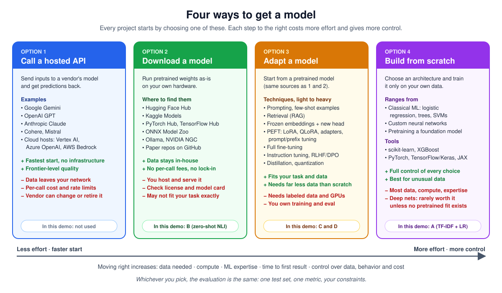

# Guide for Model Selection Walkthrough

Oct 11, 2026 · @Johnny



*The four ways to get a model, from least to most effort. This walkthrough's candidates cover options 2 to 4. Option 1, a hosted API, is the obvious fifth choice to raise in class.*

**Further reading:** [10 Hugging Face Models Worth Knowing in 2026](https://www.kdnuggets.com/10-hugging-face-models-worth-knowing-in-2026) (KDnuggets), a quick survey of models you can download or adapt (options 2 and 3).

**Follow-on demo:** [Model Families and Quantization](QuantizationGuide.md) (`quantization_family_demo.py`) covers the next two choices after picking a model: which size in its family, and which quantization level.

## How to use this companion

Read this beside the notebook, one section at a time. Each section here matches a numbered section there, and explains what the cells do, why they are written that way, and what to say about them in class.

- **First pass (about an hour):** read The big picture, then skim each section's opening paragraph. That alone lets you narrate the demo.
- **Second pass:** work through Section 2.4 (the evaluation harness) slowly, with the notebook open. It holds most of the ideas questioned.
- **Before class:** do three or four of the Experiments to try.

Conventions: `code` means a name you will see in the notebook. *Say in class* marks a sentence worth saying out loud. The notebook's own SITE STOP, KEY IDEAS and ASK THE ROOM cells are your lecture script; this companion is the explanation behind them.

## The big picture

The whole demo argues one thing: choosing a model is a decision made under constraints, and only your own evaluation can make it. Leaderboards, download counts and model cards narrow the list; they never pick the winner.

The story runs in three acts, and each act hands something to the next:

1. **Identify** turns a business question (route each customer message) into an ML task (77-way classification), a metric (macro-F1) and written constraints (latency, license, data control).
2. **Select** finds candidates on the Hub, reviews them, runs all of them through one identical evaluation, and decides with a weighted matrix.
3. **Use** packages the chosen model, loads it safely, adds a confidence threshold with a human fallback, and watches for drift. Drift is what eventually sends you back to act 1.

&#91;embedded content: the three acts of the walkthrough · with the drift loop\]

The dashed loop is often forgotten : monitoring is what tells you the original framing has stopped being true.

### Why these four candidates

They are one rung each on the adaptation ladder, so the comparison shows what each step up in effort buys.

| Candidate | What it is | What it teaches |
| --- | --- | --- |
| A · TF-IDF + logistic regression | Word counts fed to a linear classifier | A simple baseline is often strong: 0.887 macro-F1 here, trained in 20 seconds on CPU |
| B · Zero-shot NLI (bart-large-mnli) | A model that judges whether a sentence entails a label, with no training on our data | No training data needed, but 77 labels means 77 model passes per message, which breaks the latency budget |
| C · MiniLM embeddings + logistic regression | A small frozen encoder turns text into vectors; a linear model classifies them | Most of the benefit of pretraining for little cost |
| D · Fine-tuned DistilBERT | Every weight of a small transformer updated on our labels | Usually the best quality, at the highest training and serving cost |

*Say in class:* "We are not asking which model is best. We are asking which model is best for this job, under these constraints, and how we would know."

## The candidate models: names, links, and why

The shortlist was chosen by hand, against the business requirements below: one well-established model per rung of the adaptation ladder, each able to meet our constraints on paper before we test it. The notebook's search cells show the landscape; this section explains how the shortlist was cut from it.

### The models

| Candidate | Hugging Face name | Publisher | Size | License | Downloads last month |
| --- | --- | --- | --- | --- | --- |
| A · TF-IDF + logistic regression | Not on the Hub; built in the notebook with scikit-learn | You | about 4 MB | BSD-3-Clause (scikit-learn) | n/a |
| B · Zero-shot NLI | [facebook/bart-large-mnli](https://huggingface.co/facebook/bart-large-mnli) | Meta AI | about 400M parameters | MIT | about 2.6 million |
| C · Sentence embeddings | [sentence-transformers/all-MiniLM-L6-v2](https://huggingface.co/sentence-transformers/all-MiniLM-L6-v2) | Sentence Transformers project | about 22.7M parameters | Apache-2.0 | about 223 million |
| D · Base model for fine-tuning | [distilbert/distilbert-base-uncased](https://huggingface.co/distilbert/distilbert-base-uncased) | Hugging Face | about 67M parameters | Apache-2.0 | about 7.8 million |

Download counts were read from the model pages in October 2026 and change monthly. The notebook uses the short ID `distilbert-base-uncased`; the Hub redirects it to the `distilbert/` organization.

Your own fine-tuned model is a fifth repo: `<your-username>/banking77-router-demo`, private until you change it.

### The business requirements behind the choice

1. **Task fit:** classify short English customer messages into a fixed set of intents. The model must handle English text classification, directly or as a base for it.
2. **Data stays in-house:** messages contain account details, so the model must run on our own servers. That means downloadable open weights, not a hosted API.
3. **Commercial-use license:** MIT, Apache-2.0, BSD or CC-BY. The bank is a business, so research-only or non-commercial licenses are out.
4. **Fast on CPU:** routing happens while the customer waits, on CPU servers. The budget is a p95 of 100 ms per message, which favors small models.
5. **Trainable on our hardware:** any fine-tuning must fit two GTX 1080 Ti cards (11 GB each, fp32) in minutes, not days.
6. **Trustworthy supply chain:** a known publisher, a real model card, and safetensors weights so loading cannot run code.
7. **A fair test:** not already trained on banking77, so our test set is genuinely unseen and the selection exercise is real.

Requirements 1 to 3 are hard filters: fail one and the model is out. Requirements 4 and 5 are checked on paper here and measured in the notebook. Requirement 7 is specific to teaching, but it mirrors a real rule: never trust a score on data the model may have seen.

### How each candidate meets them

| Requirement | A · TF-IDF + LR | B · bart-large-mnli | C · all-MiniLM-L6-v2 | D · distilbert-base-uncased |
| --- | --- | --- | --- | --- |
| 1 · Task fit | Yes, trained on our labels | Yes, classifies against label names | Yes, embeddings plus a classifier | Yes, after fine-tuning |
| 2 · Runs in-house | Yes | Yes, open weights | Yes, open weights | Yes, open weights |
| 3 · Commercial license | Yes, BSD-3-Clause | Yes, MIT | Yes, Apache-2.0 | Yes, Apache-2.0 |
| 4 · Fast on CPU | Yes, about 1 ms | Doubtful: 77 passes of a 400M model per message. Kept to show the failure | Likely: small encoder | Likely: small, 6 layers |
| 5 · Trainable here | Seconds on CPU | No training needed | Seconds, encoder frozen | Minutes on two 1080 Ti cards |
| 6 · Supply chain | Our own code | Meta AI, model card, safetensors | Well-known project, detailed card, safetensors | Hugging Face, card notes inherited bias, safetensors |
| 7 · Not trained on banking77 | Trained only on our split | Trained on MultiNLI | Trained on general sentence pairs | Pretrained on BookCorpus and Wikipedia |

### What was left out, and why

- **Community models already fine-tuned on banking77:** they fail requirement 7, and their training data and evaluation are unknown. They stay in the demo as a warning.
- **Hosted LLM APIs:** fail requirement 2. They appear in the decision matrix as row E, filtered out without testing.
- **Larger open models, including MTEB leaders and open-weight LLMs:** likely to fail requirement 4 on CPU. They're a good extension exercise: add one as candidate F and let the harness decide.
- **BERT-base and similar:** a fair alternative to DistilBERT, but about 110M parameters and slower, for usually small gains on short messages.

*Say in class:* "These four weren't picked because they're the best models on the Hub. They were picked because each one could plausibly meet our requirements, and each one tests a different amount of adaptation."

## Section 0 · Setup

Two cells prepare everything else: one loads libraries and sets switches, the other proves the GPUs work and picks a numeric precision.

### The first cell: libraries and switches

- `SEED = 42` with `transformers.set_seed(SEED)` fixes the random number generators, so the train/validation split and fine-tuning give the same results each run. *Say in class:* reproducibility is what lets two people compare numbers at all.
- `ART` and `RESULTS` are folders under `artifacts/`. Every candidate's results are saved there as a small JSON file, and the fine-tuned model is saved there too.
- `QUICK` turns on rehearsal mode (tiny subsets, 1 training epoch) when the environment variable `DEMO_QUICK=1` is set. Numbers in this mode are meaningless; it only checks that cells run.
- `RERUN_ZERO_SHOT` and `RERUN_FINETUNE` are False by default. The two slow steps then load their saved results instead of recomputing. Set one to True to show the real computation live.
- The commented `HF_HOME` and `HF_HUB_OFFLINE` lines are your insurance against bad Wi-Fi: point at a filled cache and the Hub is never contacted.

### The GPU check (`check_gpus`)

It lists each GPU and its compute capability (`sm_61` for the 1080 Ti), then runs one tiny calculation on the GPU. That last step matters: `torch.cuda.is_available()` can say True even when the installed PyTorch has no code for your card. You saw exactly this on setup day, with the CUDA 13 build.

It then picks the training precision from the card's generation:

| Card generation | Compute capability | Precision chosen | Why |
| --- | --- | --- | --- |
| Ampere and newer (A100, RTX 30xx+) | 8.0+ | bf16 | Fast and numerically safe |
| Volta, Turing (V100, RTX 20xx) | 7.x | fp16 | Tensor cores make half precision fast |
| Pascal (your GTX 1080 Ti) | 6.x | fp32 | No bf16, and fp16 runs far slower than fp32 on these cards |

Both GPUs stay visible. During fine-tuning the Trainer splits each batch across them automatically; everything else runs on `cuda:0`.

## Section 1 · Identify

This section turns a vague business need into something you can measure: the data, a frozen test set, and constraints written down before anyone sees a result.

### The two dataset pages (Site stop 1)

- **PolyAI/banking77** is the original release. Its viewer is broken because it relies on a loading script, and current `datasets` releases no longer run those. Use it as a live example of how datasets rot.
- **mteb/banking77** is a re-upload in parquet format, made for the MTEB benchmark. Same 13,083 messages, and its viewer and SQL console work.
- **The license teaching moment:** the original says CC-BY-4.0, the mirror says MIT. Only the original author can set the license, so the CC-BY-4.0 on the original is the one that applies. *Say in class:* trust the license at the source, not on a copy.

### `load_banking77()`

It tries the Hub mirror first. If that fails (no network, or the mirror disappears), it falls back to the original authors' CSV files on GitHub. Either way it returns two tables with the same columns: `text` and `intent`.

After loading, `LABELS` is the 77 intent names in alphabetical order, and `label2id` / `id2label` translate between names and the numbers a neural network needs.

### The splits and the fingerprint

- **Train / validation:** 10% of the training data is held back as a validation set, *stratified* so every intent keeps its proportion. Validation is for choices like the confidence threshold later.
- **Test:** the official 3,080-message test set, never used to make any choice.
- **Fingerprint:** `TEST_FINGERPRINT` is a short hash of the test set's text. If anyone evaluates on a different or modified test set, the fingerprint changes. It is printed into every result and into the model card. *Say in class:* this is how you prove your numbers came from the test set you claim.

### The class balance chart

The left chart shows messages per intent, sorted, with the ratio of the largest to smallest class in the title. The right one shows message lengths: most are short, about 10 words, which is why a 64-token limit is enough later. The smallest intents print underneath; watch whether they reappear as the weakest intents in the results.

### `CONSTRAINTS`

Three rules, each a number or a yes/no:

- `p95_latency_ms_cpu`: 95% of single messages must be classified within this many milliseconds on a CPU. Default 100.
- `allowed_licenses`: licenses that permit commercial use.
- `data_may_leave_environment`: False, which rules out hosted APIs before any testing.

Have the class set the latency number out loud before results appear. If they set it afterwards, they will unconsciously set it to make their favorite model pass.

## Sections 2.1 to 2.3 · Search, review, leaderboards

These sections show that everything you click on the Hub website can also be done in code, which makes the search repeatable and the review consistent.

### `hub_search()`

A thin wrapper around `HfApi().list_models()`, the same search the Hub's website runs. The arguments you will see:

- `pipeline_tag="text-classification"` is the website's **Tasks** filter.
- `search="banking77"` matches words in model names.
- `filter="sentence-transformers"` matches a tag, here the library.
- `sort="downloads"` orders by downloads in the last month, most first.
- `expand=[...]` asks the server to include extra fields (license, parameter count, last update) in the same request.

Each model comes back as a `ModelInfo` object; the function pulls out a few fields into a table. Parameter counts come from the model's safetensors metadata, so models stored only in older formats show a blank there.

*Teaching point:* popularity is not fitness. A model with millions of downloads may be trained for sentiment, in another language, or on data you can't use.

### The community banking77 models

The search for "banking77" finds models other people already fine-tuned on our exact dataset, some with high reported scores. The ASK THE ROOM question is whether to just take the best one. The answer is no, for three reasons: you don't know what they trained on (possibly including the test set), how they measured, or who published them. Their number only means something if you rerun it on your fingerprinted test set.

### `review_model()`

This automates the six-point model card check. For one model ID it:

1. Calls `api.model_info(..., files_metadata=True, securityStatus=True)` to get the file list, file sizes and the Hub's security scan summary.
2. Counts safetensors files and pickle-format files (`.bin`, `.pt`, `.pkl` and similar).
3. Downloads the model card text with `ModelCard.load()` and checks for key phrases: intended use, training data, evaluation, limitations.
4. Records the license from the card's metadata and the `sha`, the exact commit reviewed.

Keyword checks only triage: they catch empty or thin cards fast, but a person still has to read the card. The `sha` matters because a model repo can change after you review it; pinning that commit later guarantees you ship what you reviewed.

### The MTEB leaderboard (Site stop 5)

MTEB ranks embedding models across many tasks, and **Banking77Classification is one of them**. That creates two lessons in one screen:

- **Contamination risk:** models tuned on MTEB data may score well partly because they have seen this distribution before.
- **Fit, not rank:** compare the leaders' size and memory columns with `all-MiniLM-L6-v2`. Many leaders are far larger, and against a CPU latency budget they may not qualify at all.

Leaderboards are a reasonable place to build a shortlist, not a place to make the decision.

## Section 2.4 · The evaluation harness

The harness is one function, `evaluate_model()`, that every candidate goes through. Each candidate supplies only a way to predict; the test set, metrics and timing are identical for all four. That sameness is what makes the comparison fair.

### What `evaluate_model()` takes

- `predict_batch`: a function that takes a list of messages and returns a list of predicted intents. Used for accuracy, run on the GPU where possible.
- `predict_one_cpu`: a function that classifies one message on the CPU. Used only for timing, because production routing handles one message at a time on CPU servers.
- `size_mb`: the model's memory footprint, a stand-in for serving cost.
- `eval_df`: which messages to test on. The default is the frozen test set; zero-shot uses a smaller sample.

It returns a dictionary and saves it to `artifacts/results/` as JSON. `cached()` reads that file back, which is how the slow steps are skipped in class.

### Macro-F1

For each intent, F1 balances two questions. *Precision:* when the model says "card arrival", how often is it right? *Recall:* of all real card-arrival messages, how many did it catch? F1 is their harmonic mean, which is low if either one is low.

```latex
F_1 = \frac{2 \cdot \text{precision} \cdot \text{recall}}{\text{precision} + \text{recall}} \qquad \text{macro-}F_1 = \frac{1}{77}\sum_{k=1}^{77} F_{1,k}
```

**Macro** means compute F1 for each of the 77 intents separately, then take the plain average. Every intent counts equally, however rare. The alternative, *micro* averaging, pools all messages, so common intents dominate and a model can ignore rare ones and still score well. *Say in class:* we chose macro because a misrouted "lost or stolen card" message matters as much as a common one.

### `bootstrap_ci()`: how sure are we?

A test set is a sample, so its score is an estimate. The bootstrap measures how much that estimate would wobble with a different sample:

1. Draw 3,080 messages from the test set *with replacement*, so some appear twice and some not at all.
2. Compute macro-F1 on that resampled set.
3. Repeat 1,000 times, giving 1,000 scores.
4. The middle 95% of those scores (from the 2.5th to the 97.5th percentile) is the 95% confidence interval.

How to read it: if two models' intervals overlap a lot, the test set cannot reliably tell them apart, and something else (cost, latency, simplicity) should decide. The `seed` keeps the resampling identical across candidates.

### `worst_recalls()`

It computes recall for every intent and returns the five lowest. These are where misroutes concentrate. If the same intents are weak for every model, the problem is usually the data (two intents that genuinely overlap, like card arrival versus card delivery estimate), not the model.

### `p95_latency_ms()`: timing that matches production

1. Run a few warm-up predictions first, because the first calls are slow while things load into memory and caches.
2. Time each of the next 100 messages one at a time with `time.perf_counter()`.
3. Report the 95th percentile: 95% of messages were at least this fast.

Why p95 and not the average: users feel the slow cases. An average of 20 ms can hide a tail of 300 ms. Why one at a time on CPU: batching on a GPU would flatter the neural models, but that is not how they will be served.

## Section 2.5 · The four candidates

Each candidate cell builds a predictor, wraps it in the two functions the harness wants, and calls `evaluate_model()`. What differs is how much each one learns from our data.

### A · TF-IDF + logistic regression

- **TF-IDF** turns each message into a long vector with one slot per word or word pair (`ngram_range=(1, 2)`, so "card arrived" counts as a feature). Each slot's value is how often the term appears, scaled down for terms common across all messages, like "my". `sublinear_tf=True` dampens repeated words.
- **Logistic regression** learns a weight per term per intent and picks the intent with the highest score. `C=10` means light regularization, which suits lots of short texts. `max_iter=3000` just lets the solver finish.
- `make_pipeline` chains the two, so `.fit()` and `.predict()` handle raw text.
- Size is measured by pickling the whole pipeline (`pickle.dumps`). Fine here because it's our own object; never unpickle a stranger's file (Section 3 shows why).

It reached 0.887 macro-F1 on the full data in about 20 seconds of CPU training. It cannot handle words it never saw in training, or meaning without shared words ("I didn't get my card" versus "card hasn't arrived").

### B · Zero-shot NLI

- **NLI** (natural language inference) models judge whether a premise *entails* a hypothesis. bart-large-mnli was trained on MultiNLI to do exactly that.
- The zero-shot trick: the message is the premise, and each label becomes a hypothesis through `ZS_TEMPLATE`: "This customer message is about card arrival." The label whose hypothesis gets the highest entailment score wins.
- Labels are made readable first (`card_arrival` becomes "card arrival") because the model reads them as English.
- **The cost:** 77 labels means 77 full passes of a 400-million-parameter model per message. That is why it's evaluated on a 5-per-intent sample (385 messages), timed on only 5 messages, and why it fails the latency constraint.

*Teaching point:* zero-shot is great for a prototype with no labels. Once you have labels, cheaper rungs usually beat it.

### C · MiniLM embeddings + logistic regression

- `SentenceTransformer` encodes each message as 384 numbers (an *embedding*) that place similar meanings near each other. The encoder was pretrained on about a billion sentence pairs and is **frozen**: we never change its weights.
- `normalize_embeddings=True` scales each vector to length 1, so the classifier compares direction (meaning), not length.
- A logistic regression is trained on those vectors, like candidate A but on meaning instead of word counts.
- Why it's cheap: encoding runs once, and training the classifier takes seconds. Why it may trail D: the encoder was never tuned for banking intents.

### D · Fine-tuned DistilBERT

- `AutoModelForSequenceClassification` loads DistilBERT (a smaller, faster distillation of BERT) and adds a fresh 77-way output layer. The "newly initialized" warning when it loads is expected: that new layer starts random.
- `to_ds` tokenizes text into word-piece IDs, cut at 64 tokens (`max_length=64`), enough for these short messages.
- `TrainingArguments`, in plain words: 4 passes over the data (`num_train_epochs`), learning rate 5e-5 with warm-up over the first 10% of steps (`warmup_steps=0.1`), 32 messages per GPU per step, a check on the validation set after each epoch, keeping only the epoch with the best validation macro-F1 (`load_best_model_at_end`), and fp32 on your cards.
- `Trainer` runs the loop: forward pass, loss, backpropagation, weight update. With two GPUs it splits each batch across both.
- `trainer.save_model()` writes `model.safetensors` plus the config and tokenizer to `artifacts/distilbert-banking77/`. The next cell wraps it in a `pipeline` for prediction.

*Say in class:* every rung up the ladder buys quality with more data, compute, and things that can go wrong.

## Section 2.6 · Results and the decision matrix

The results table shows what each model achieved; the matrix turns those numbers, plus stated priorities, into a choice someone can argue with.

### Reading the results cell

- The table lists macro-F1, its 95% interval, p95 CPU latency, whether that meets the budget, model size, and `n_eval` (how many test messages were used; zero-shot's is smaller).
- **Left chart:** macro-F1 with interval whiskers. Overlapping whiskers mean the test set can't separate those two models.
- **Right chart:** latency on a log scale, so 1 ms and 1,000 ms fit on one axis, with the budget as a dashed line.
- The worst-intents printout follows. Look for intents that are weak for every model.

### Step 1 of the matrix: hard filters

Each candidate is checked against the constraints. Failing any one removes it, with the reason in `filtered_by`. A row **E · Hosted LLM API** is added without running anything: it fails the data-control rule, which is the point. *Say in class:* a hard constraint is a filter, not a weight. No amount of accuracy buys back a broken rule.

Licenses come from `REVIEWS` (Section 2.2), except A, which is our own scikit-learn model.

### Step 2: scoring the survivors

Each criterion becomes a score from 1 to 5 with `scale()`: the best survivor gets 5, the worst gets 1, the rest fall in between.

| Criterion | Measured from | Better is | Default weight |
| --- | --- | --- | --- |
| Quality | macro-F1 | higher | 40% |
| Latency | p95 ms, on a log scale | lower | 15% |
| Cost | model size in MB, on a log scale (a stand-in for serving cost) | lower | 20% |
| Data control | all survivors run in-house, so all get 5 | n/a | 15% |
| Ops effort | `OPS_EFFORT`, a judgment call, labeled as such | easier | 10% |

The weighted total is the sum of score times weight. Two honest caveats to say out loud:

- **Min-max scaling exaggerates gaps.** With three survivors, one always gets 5 and one always gets 1, even if they differ by a hair. That's acceptable for a discussion tool, not for a final verdict.
- **Log scales** are used for latency and size because a jump from 1 to 10 ms matters about as much as 10 to 100 ms.

### Step 3: sensitivity

The last cell doubles and then halves each weight in turn, rescaling the others, and records the winner each time. A "YES" in `flipped` means the decision hinges on how much you care about that criterion. That is exactly the conversation to have with stakeholders.

### If the matrix doesn't pick D

Section 3 packages D either way, because it shows the full Hub workflow. If A or C wins, say so plainly: the process worked, and the simple model earned the job. The model card has a line to record that difference.

## Section 3 · Use

This section makes the chosen model something other people can trust and operate: documented, pinned, loaded safely, guarded by a fallback, and watched.

### Step 1: the model card

The cell builds a `README.md` from the actual results and saves it next to the model. The block between the `---` lines is YAML metadata that the Hub reads for its sidebar (license, base model, dataset, task). The rest is the card itself: intended use, out-of-scope uses, training data, evaluation with the test fingerprint, the decision record, limitations, and how to load it. *Say in class:* we just did to our own model what we did to everyone else's in Section 2.2.

### Step 2: publishing and pinning

- `api.create_repo(..., private=True, exist_ok=True)` creates the repo if needed.
- `api.upload_folder()` uploads the model folder as one commit and returns its `oid`, the commit hash.
- `REVISION` stores that hash. From here on, everything loads that exact commit.

Private repos are visible only to you while logged in. Others need to be added, or you change visibility in the repo's settings.

### Step 3: loading safely, and the pickle demo

The three loading settings each close one risk:

| Setting | What could go wrong without it |
| --- | --- |
| `revision=<commit hash>` | Someone pushes a changed or malicious model to the same repo name, and you load it silently |
| `trust_remote_code=False` | A repo can ship Python files that run when the model loads; this refuses to run them |
| `use_safetensors=True` | Older `.bin` weights are pickle files, and loading a pickle can run any code |

The pickle demo makes the last risk concrete. Python's pickle stores objects as instructions for rebuilding them. `__reduce__` lets an object say "to rebuild me, call this function with these arguments". Here that's a harmless `print`, but it could be any function, such as one that deletes files or sends data out. `pickle.loads()` runs it the moment the bytes are read.

The second half uses `pickletools.genops()` to list the instructions *without running them*: you can see `builtins` and `print` named, then `REDUCE`, which means "call it". The Hub's pickle scan does essentially this. Safetensors avoids the problem entirely: it stores only raw numbers and a header describing them, with no instructions.

### Step 4: the confidence threshold

The classifier always picks one of 77 intents, even for nonsense. Each prediction comes with a score from 0 to 1, the model's own confidence. The cell:

1. Scores every validation message (never the test set, which stays untouched).
2. For each candidate threshold from 0 to 0.99, computes **coverage** (the share of messages above it) and **accuracy** on just those messages.
3. Picks the lowest threshold that reaches `TARGET_ACC` (97%), which keeps coverage as high as possible.

If no threshold reaches the target, it falls back to the threshold that covers 80% of messages and prints a warning. That is a finding to discuss, not a bug. The chart shows the trade-off: move right and the model handles more, but less accurately.

The resulting `route()` function sends confident predictions to their queue and everything else to `human_review`, keeping the model's guess for the reviewer.

### Step 5: breaking it

The out-of-scope messages (weather, mortgages, Spanish, gibberish) show what a closed label set does with input it was never meant for. Some will route confidently to a wrong queue: the scores are not well calibrated, so a high score does not guarantee the message is in scope. The threshold catches many such messages, not all. *Say in class:* the fix for "none of the above" is to train an out-of-scope class, not a cleverer threshold.

The optional Gradio cell puts `route()` behind a small web page on port 7860 so you can try their own messages.

### Step 6: drift

The cell builds a fake "next week" from the test set: card-related messages tripled (a product launch), random typos in 30% of messages, and the out-of-scope messages repeated 20 times. Then it compares:

- **Jensen-Shannon distance** between the predicted-intent mix last week and this week. 0 means identical, 1 means completely different. It needs no labels, so it works on day one.
- **Mean confidence**, and **the share sent to human review**. Both shift when inputs look unfamiliar.
- **Macro-F1 on in-scope messages**, computed as if labels had arrived later. In real life this lags by days or weeks.

`TRIGGERS` holds limits agreed before launch; crossing one prints ALERT. *Say in class:* decide what will make you act before the incident, while nobody is under pressure.

## Questions

These are the questions a sharp master's class is likely to raise, with short answers you can give and extend.

**"Why not just use a big LLM for everything?"** Our data-control rule forbids sending messages out, which removes hosted LLMs before any test. Even self-hosted, a large model costs far more per message, is slower, and must still beat a 20-second baseline on our eval to earn its place. LLMs shine when labels are scarce or the task is open-ended; this one has 10,000 labels and a closed set of answers.

**"Why macro-F1 and not accuracy?"** Accuracy weights every message equally, so frequent intents dominate. Macro-F1 weights every intent equally, so a model can't neglect rare ones. Here the classes are only mildly imbalanced, so the two will be close; the habit matters more on skewed data.

**"Isn't the bootstrap just making up data?"** No. It reuses the real test messages to estimate how much the score would vary with a different sample of the same kind. It assumes the test set represents production, which is the assumption every test score already makes.

**"Why time on CPU when we have GPUs?"** Because the constraint says the serving tier is CPU. Measure the way you will deploy. A GPU-batched number would be accurate but irrelevant.

**"Why not tune the threshold on the test set?"** Then the test set has helped make a choice, and its score is no longer an honest estimate of the future. Validation exists for choices; test is for the final report.

**"Couldn't we fine-tune the zero-shot model, or use a bigger encoder?"** Yes, and that's the point of the ladder: each would be a new candidate that goes through the same harness and matrix. The notebook's `FT_BASE` line already suggests ModernBERT as an alternative.

**"The weights in the matrix are arbitrary. Doesn't that make it meaningless?"** They're not arbitrary, they're explicit. Every choice already embeds weights; the matrix writes them down so people can disagree productively. The sensitivity check shows whether the disagreement actually changes the outcome.

**"Why is the hosted LLM in the matrix if we never ran it?"** To show that some decisions are made by constraints, before any experiment. Writing it down records that it was considered and why it was excluded.

**"Is safetensors actually safe?"** Safer: it contains only tensor data and a small header, so loading it cannot run code. It does not guarantee the model behaves well. A model can still be biased, backdoored or wrong, which is what the card, the eval and monitoring are for.

**"What if the community banking77 model beats ours?"** Then run it through `review_model()` and the same harness. If it survives the card review and the license check, and wins on our fingerprinted test set, it's a legitimate candidate. The process doesn't care who trained the model.

## Experiments to try before class

Each of these takes a minute or less because the slow steps are cached. Change one thing, rerun from that cell down, and note what moved. Undo the change afterwards.

| # | Change | Where | Rerun from | What to watch |
| --- | --- | --- | --- | --- |
| 1 | Latency budget to 10, then 1000 | `CONSTRAINTS` | Results cell | Which candidates survive the filter, and whether the winner changes |
| 2 | Quality weight to 0.8 | `WEIGHTS` | Matrix scoring cell | The weighted totals and the sensitivity table |
| 3 | Remove `"mit"` from `allowed_licenses` | `CONSTRAINTS` | Matrix filter cell | Zero-shot fails a second rule; a license can decide on its own |
| 4 | `TARGET_ACC` to 0.99, then 0.90 | Threshold cell | Threshold cell | Coverage: how much the model handles alone at each target |
| 5 | Typo rate `0.08` to `0.25` | `add_typos` in the drift cell | Drift cell | Confidence drop, human-review share, and which triggers fire |
| 6 | Add your own messages | `out_of_scope` list | Breaking-it cell | Which wrong answers come back confident |
| 7 | `C=10` to `C=1` in candidate A | Candidate A cell | Candidate A cell | How much regularization changes the baseline |

Two slower ones, worth trying once:

- **Retrain D with 1 epoch:** set `RERUN_FINETUNE = True` and change `num_train_epochs` to 1. You'll see how much the extra epochs buy, and how long a live fine-tune takes on your cards.
- **Try a different encoder for C:** swap `EMB_ID` for a larger sentence-transformers model from the MTEB leaderboard, then compare quality gain against latency cost. This is the leaderboard-versus-your-eval lesson in miniature.

## Glossary

| Term | Meaning in this notebook |
| --- | --- |
| Bootstrap | Resampling the test set with replacement many times to see how much a score would vary |
| Calibration | Whether a model's confidence matches how often it is right; ours is not calibrated |
| Compute capability | NVIDIA's generation number for a GPU (6.1 for the 1080 Ti); decides which PyTorch builds and precisions work |
| Concept drift | The link between input and correct answer changes, e.g. a new product makes old phrasing mean something else |
| Contamination | Test data leaking into a model's training data, inflating its scores |
| Coverage | The share of messages the model handles itself, above the confidence threshold |
| Data drift | The inputs change: new topics, new phrasing, typos |
| Embedding | A fixed-length list of numbers representing a text's meaning |
| Epoch | One full pass over the training data |
| Fine-tuning | Continuing to train a pretrained model's weights on your own labeled data |
| fp32 / fp16 / bf16 | Number formats for training: 32-bit full precision, and two 16-bit formats that are faster on newer GPUs |
| Jensen-Shannon distance | A 0 to 1 measure of how different two distributions are |
| Macro-F1 | F1 computed per class, then averaged with every class counted equally |
| Model card | A model's documentation: intended use, data, evaluation, limitations, license |
| NLI | Natural language inference: does one sentence entail another? |
| p95 latency | The time within which 95% of requests finish |
| Pickle | Python's object format; loading one can run arbitrary code |
| Pipeline (transformers) | A wrapper that bundles tokenizer and model behind one call, e.g. `pipeline("text-classification")` |
| Revision / sha | A specific commit of a Hub repo; pinning it guarantees the same files every time |
| Safetensors | A weight format holding only raw numbers plus a header, so loading cannot run code |
| Stratified split | A split that keeps each class's proportion the same in every part |
| TF-IDF | Term frequency times inverse document frequency: word counts that down-weight words common everywhere |
| Tokenizer | Splits text into the word pieces a transformer reads, and maps them to IDs |
| Zero-shot | Classifying into labels the model was never trained on, using only their names |

## Setup lessons from your server

Every problem on setup day came from one of two things: the wrong Python, or the wrong PyTorch build. These also make good war stories for class.

| Symptom you saw | Cause | Fix |
| --- | --- | --- |
| `torch==2.14.0` not found; only 2.6 to 2.8 listed | pip was running under Python 3.9, and torch 2.9+ needs 3.10+ | A new environment with Python 3.12 (your conda env `model-demo`) |
| `No matching distribution found for transformers>=5.0` | Same: still Python 3.9; transformers 5 needs 3.10+ | Activate the 3.12 environment before installing |
| Notebook kernel showed 3.9.13 | VS Code picked the workspace's own `.venv` on the NAS | Select Another Kernel, then choose the `model-demo` environment |
| "No kernel image is available" on the GPU | The requirements install replaced the CUDA 12.6 build with the default CUDA 13 build, which has no Pascal kernels | Reinstall from the cu126 index; `torch==2.14.1` is now pinned in requirements.txt |
| `CONSTRAINTS is not defined` | One earlier cell hadn't run after a kernel restart | Run Above, or Restart and Run All |
| Model not on the Hub | `PUSH_TO_HUB` was False, or not logged in | `hf auth login` with a write token, then the push cell with True |

Three habits prevent all of these:

1. **Check before you install:** `which python` and `python --version` in the terminal, and `sys.executable` in the notebook.
2. **Pin what is fragile.** For your 1080 Ti cards that is torch from the cu126 index. PyTorch 2.14 is the last release with prebuilt wheels for Pascal.
3. **Restart and Run All** before class, never piecemeal runs.

One last practical note: VS Code auto-activates the workspace's 3.9 `.venv` in new terminals. Run `conda activate model-demo` in each new terminal before installing anything.
